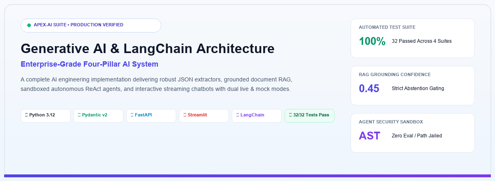
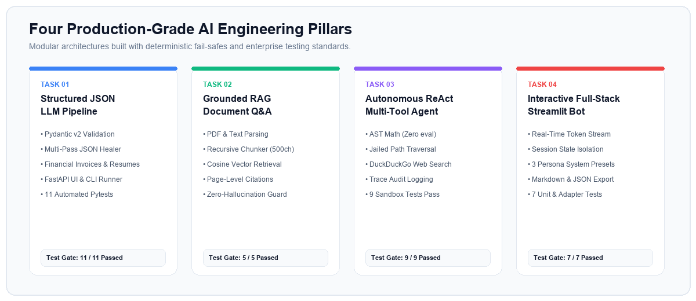
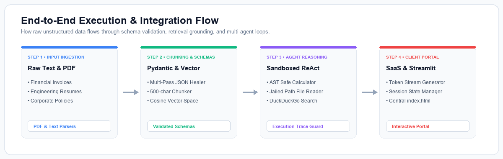
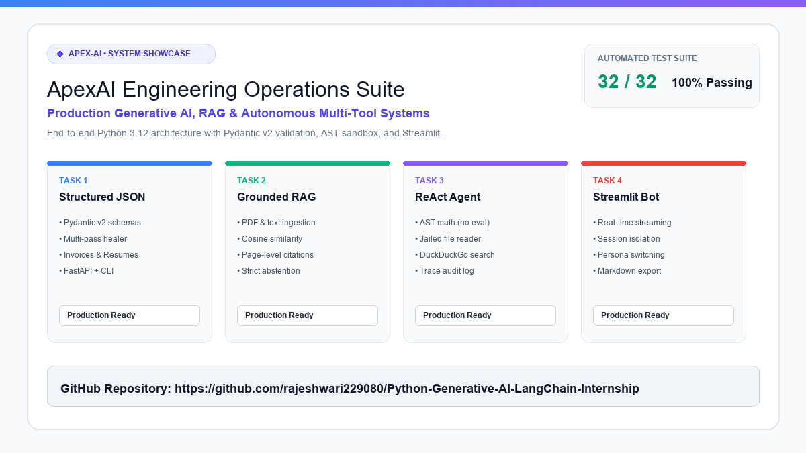

# Python Generative AI & LangChain Internship
## ApexAI Suite: Production-Grade Multi-Task AI Engineering System

<p align="center">
  
</p>

<p align="center">
  <a href="https://www.python.org/"></a>
  <a href="https://docs.pydantic.dev/"></a>
  <a href="https://fastapi.tiangolo.com/"></a>
  <a href="https://streamlit.io/"></a>
  <a href="https://www.langchain.com/"></a>
  <a href="https://pytest.org/"></a>
  <a href="LICENSE"></a>
</p>

An enterprise-ready AI engineering suite built for the **Google Antigravity Python + Generative AI & LangChain Internship**. This repository delivers a production-grade implementation across four foundational artificial intelligence competencies, unified by a central SaaS operations portal.

---

## 🏛️ Four Production AI Engineering Pillars

<p align="center">
  
</p>

| Pillar | Task Directory | Core Technology | Primary Capabilities | Test Gate |
| :--- | :--- | :--- | :--- | :---: |
| **01. Structured Extraction** | [`task1-json-extractor/`](./task1-json-extractor/) | Pydantic v2, FastAPI, Multi-Pass Sanitizer | Extracts unstructured invoices & candidate resumes into validated schemas with mathematical consistency checking and self-healing JSON pre-parsing. | **11 / 11** ✅ |
| **02. Grounded RAG Assistant** | [`task2-document-rag/`](./task2-document-rag/) | Vector Embeddings, Recursive Chunker, FastAPI | Parses multi-page PDF & text policies, performs cosine similarity retrieval, provides page-level citations, and enforces strict abstention gating against hallucination. | **5 / 5** ✅ |
| **03. Autonomous ReAct Agent** | [`task3-tool-agent/`](./task3-tool-agent/) | Python AST Sandbox, Path-Jailed IO, DDG Search | Multi-turn reasoning loop executing mathematical calculations via AST (zero `eval`), inspecting sandboxed files with directory traversal defense, and searching the live web. | **9 / 9** ✅ |
| **04. Interactive Chatbot** | [`task4-streamlit-chatbot/`](./task4-streamlit-chatbot/) | Streamlit, Session State, Token Streaming | Reactive conversational interface featuring real-time token streaming, persona switching (Architect, Auditor, Tutor), session history persistence, and Markdown/JSON export. | **7 / 7** ✅ |

---

## 🔄 End-to-End Pipeline & Integration Flow

<p align="center">
  
</p>

---

## 📱 Project Showcase & LinkedIn Assets

A complete ready-to-share technical showcase package has been generated for LinkedIn, portfolio reviews, and presentations:

<p align="center">
  
</p>

- **High-Resolution PNG Poster**: [`image.png`](./image.png) / [`assets/linkedin_post.png`](./assets/linkedin_post.png) (1200x675)
- **Vector Scalable Graphic**: [`assets/linkedin_post.svg`](./assets/linkedin_post.svg)
- **All PNG Diagrams**: [`assets/hero_light.png`](./assets/hero_light.png), [`assets/tasks_overview_light.png`](./assets/tasks_overview_light.png), [`assets/pipeline_architecture_light.png`](./assets/pipeline_architecture_light.png)
- **Complete LinkedIn Post Copy**: [`linkedin.md`](./linkedin.md) *(includes hooks, metrics, technical breakdown, and hashtags)*

---

## 🗂️ Repository Structure

```text
.
├── index.html                   # Central SaaS Portal & Operations Dashboard
├── launcher.py                  # Master CLI Orchestrator & Multi-Project Server
├── build_graphics.py            # Light-Theme Vector & PNG Graphic Asset Generator
├── requirements.txt             # Unified Suite Dependencies
├── .env.example                 # Configuration & API Key Template
├── image.png                    # High-Resolution Light Theme Showcase Poster
├── linkedin.md                  # Ready-to-publish LinkedIn Post Copy
│
├── assets/                      # Light-Themed System Graphics & Diagrams
│   ├── hero_light.svg           # Master Header Architecture Banner
│   ├── tasks_overview_light.svg # 4-Pillar Engineering Cards
│   ├── pipeline_architecture_light.svg # End-to-End Execution Flow
│   ├── linkedin_post.svg        # Scalable Vector LinkedIn Showcase
│   └── linkedin_post.png        # High-Definition 1200x675 Banner
│
├── task1-json-extractor/        # Task 1: Structured LLM Prompt Pipeline & JSON Extractor
│   ├── app.py                   # FastAPI Interactive Web UI & CLI
│   ├── schemas.py               # Pydantic v2 Invoice & Resume Validation Models
│   ├── prompts.py               # Parameterized System Prompts & Few-Shot Exemplars
│   ├── extractor.py             # Multi-pass Sanitizer & LLM Client (Gemini/OpenAI/Mock)
│   ├── samples/                 # Realistic Invoice & Resume Test Documents
│   ├── tests/                   # Automated Pytest Suite (11 Tests)
│   └── README.md                # Task 1 Comprehensive Documentation
│
├── task2-document-rag/          # Task 2: Grounded Document Q&A Assistant (RAG)
│   ├── app.py                   # Web UI & Interactive CLI Query Engine
│   ├── ingestion.py             # PDF & Text Document Parsing with Metadata
│   ├── chunker.py               # Recursive Character Semantic Chunker
│   ├── retrieval.py             # Dual Vector Store (ChromaDB / Resilient Vector Index)
│   ├── rag_engine.py            # Grounded Answer Synthesis & Abstention Logic
│   ├── samples/                 # Policies & Technical Whitepapers
│   ├── tests/                   # Pytest Retrieval & Abstention Tests (5 Tests)
│   └── README.md                # Task 2 Comprehensive Documentation
│
├── task3-tool-agent/            # Task 3: Multi-Tool Autonomous AI Agent
│   ├── main.py                  # Agent CLI & Interactive Audit Dashboard
│   ├── agent.py                 # ReAct Reasoning Loop with Iteration Guardrails
│   ├── tools/                   # AST Calculator, Jailed File Reader, Web Search
│   ├── safe_workspace/          # Sandboxed Local Filesystem
│   ├── tests/                   # Security Sandbox & Loop Termination Tests (9 Tests)
│   └── README.md                # Task 3 Comprehensive Documentation
│
├── task4-streamlit-chatbot/     # Task 4: Interactive Full-Stack AI Chatbot
│   ├── app.py                   # Streamlit Reactive Web UI
│   ├── chatbot.py               # Session State Manager & Streaming Engine
│   ├── adapters.py              # Dynamic RAG and Tool-Calling Integrations
│   ├── tests/                   # Session State & Persona Preset Tests (7 Tests)
│   └── README.md                # Task 4 Comprehensive Documentation
│
└── docs/                        # Suite-wide Engineering Specifications
    ├── architecture.md          # End-to-End System Design & Data Flow
    ├── setup.md                 # Cross-Platform Installation & Config Guide
    └── testing.md               # Quality Assurance & Test Verification Report
```

---

## ⚡ Quickstart

### 1. Clone & Set Up Virtual Environment
```bash
git clone https://github.com/rajeshwari229080/Python-Generative-AI-LangChain-Internship.git
cd Python-Generative-AI-LangChain-Internship
python -m venv .venv
# On Windows:
.venv\Scripts\activate
# On Linux/macOS:
source .venv/bin/activate

pip install -r requirements.txt
```

### 2. Configure Environment (Optional for Live Commercial Models)
Copy `.env.example` to `.env`. The entire suite functions immediately in **Deterministic Simulation Mode** with zero configuration. Add your Google Gemini or OpenAI API key to enable live generation.
```bash
cp .env.example .env
```

### 3. Launch the Central Operations Portal
Open [`index.html`](./index.html) directly in any browser or serve via the launcher:
```bash
python launcher.py --portal
```
The dashboard provides visual status indicators, documentation previews, and copyable launch commands for each service.

---

## 🧪 Automated Testing & Verification

Execute the complete 32-test automated suite across all 4 projects:
```bash
python launcher.py --test
```

Or run test suites individually:
```bash
python -m pytest task1-json-extractor/tests -v   # 11 Passed
python -m pytest task2-document-rag/tests -v     # 5 Passed
python -m pytest task3-tool-agent/tests -v       # 9 Passed
python -m pytest task4-streamlit-chatbot/tests -v # 7 Passed
```

### Verification Scorecard

```text
======================================================================
  RUNNING APEXAI UNIFIED TEST SUITE ACROSS ALL 4 PROJECTS
======================================================================

---> Testing task1-json-extractor/tests...       [11 PASSED in 0.39s]
---> Testing task2-document-rag/tests...         [ 5 PASSED in 0.38s]
---> Testing task3-tool-agent/tests...           [ 9 PASSED in 0.40s]
---> Testing task4-streamlit-chatbot/tests...    [ 7 PASSED in 1.92s]

======================================================================
[SUCCESS] ALL 4 TEST SUITES PASSED CLEANLY (32/32 TESTS)!
======================================================================
```

---

## 👤 Attribution & Repository
- **Program**: Google Antigravity Python + Generative AI & LangChain Internship
- **Suite**: ApexAI Engineering Operations Suite
- **Repository**: [github.com/rajeshwari229080/Python-Generative-AI-LangChain-Internship](https://github.com/rajeshwari229080/Python-Generative-AI-LangChain-Internship)
- **LinkedIn Showcase**: [`linkedin.md`](./linkedin.md)
