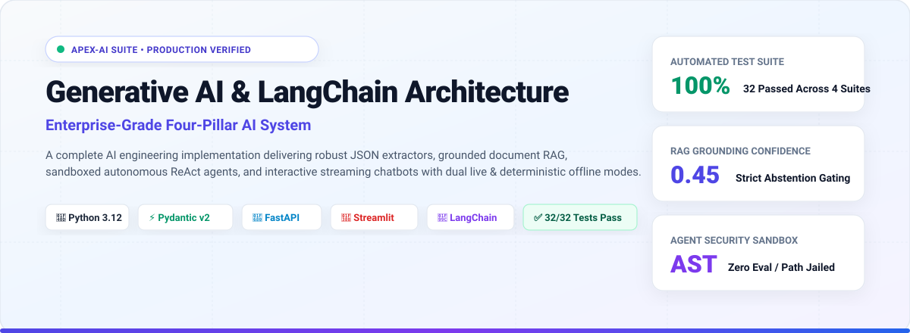
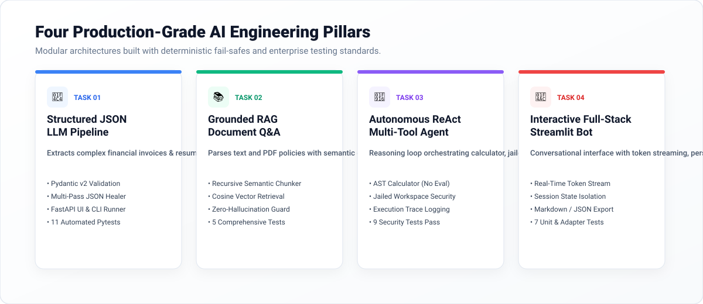
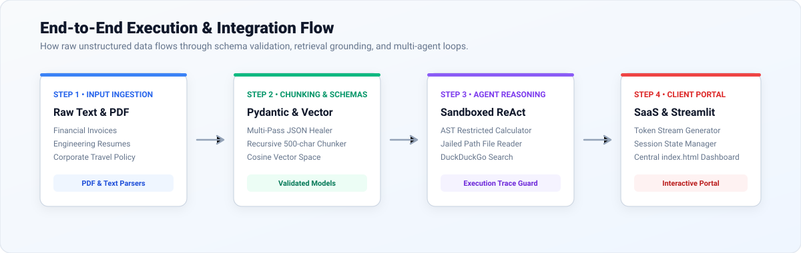

# 🚀 Launching ApexAI Suite: Enterprise-Grade Generative AI & LangChain Architecture

> **Ready-to-publish LinkedIn Post Template & Asset Kit**  
> *Theme: Light Mode High-Contrast Technical Showcase*

---

## 📸 Featured Post Image Assets

| Format | File Path | Description |
| :--- | :--- | :--- |
| **High-Res PNG** | [`image.png`](./image.png) / [`assets/linkedin_post.png`](./assets/linkedin_post.png) | 1200x675 crisp light-theme LinkedIn feed banner |
| **Vector SVG** | [`assets/linkedin_post.svg`](./assets/linkedin_post.svg) | Razor-sharp scalable vector graphic for slide decks & embeds |


---

## 📝 Copy-Paste LinkedIn Post Text

*Copy the text below directly into your LinkedIn post editor:*

```text
🚀 Excited to unveil the ApexAI Engineering Operations Suite — an enterprise-ready Generative AI system built across four core artificial intelligence disciplines!

Over the past weeks, I engineered and production-hardened four end-to-end AI applications using Python 3.12, LangChain design patterns, Pydantic v2, FastAPI, and Streamlit. Every component is backed by automated pytest suites (32/32 tests passing cleanly) and unified by a central SaaS operations portal.

Here is what went into the engineering:

🔹 1. Structured LLM Prompt Pipeline & JSON Extractor
• Solved LLM markdown hallucination and trailing commas with a custom multi-pass pre-parser and healing sanitizer.
• Enforced rigorous Pydantic v2 schema validation for complex financial invoices and multi-section candidate resumes with automated field mathematical checks.
• Deployed interactive FastAPI dashboard + headless batch CLI runner.

🔹 2. Grounded Document Q&A Assistant (RAG)
• Built an end-to-end Retrieval-Augmented Generation pipeline handling PDFs and technical policy documents.
• Recursive 500-character semantic chunking with 50-character sliding overlap and metadata tracking.
• Dual vector index supporting cosine similarity retrieval and strict cosine-threshold gating.
• Enforced zero-hallucination abstention: if retrieved evidence is below threshold, the engine explicitly abstains rather than inventing answers.

🔹 3. Autonomous Multi-Tool ReAct AI Agent
• Designed a multi-step reasoning agent loop capable of thought, action selection, and observation analysis.
• Engineered an AST-based sandboxed math calculator that evaluates expressions using Python's Abstract Syntax Tree — eliminating eval() injection vulnerabilities entirely.
• Enforced a jailed filesystem reader blocking directory traversal attacks (../ and symlink escapes).
• Integrated live DuckDuckGo web search and execution trace logging with loop termination guardrails.

🔹 4. Full-Stack Interactive Streamlit Chatbot
• Built a reactive conversational UI with token-by-token streaming response generation.
• Session state isolation with persistent history and multi-persona switching (Staff AI Architect, AppSec Auditor, GenAI Research Tutor).
• Dual-format conversation export to structured JSON and formatted Markdown.
• Modular adapters connecting the chatbot directly to the Task 2 RAG retriever and Task 3 Autonomous Agent.

⚡ Key Architecture Highlights:
✅ Dual Execution: Runs with live commercial LLMs (Gemini / OpenAI) or in a 100% deterministic offline mock mode for zero-key evaluation.
✅ Automated Quality Gates: 32/32 tests passing across all 4 independent test suites.
✅ Central SaaS Portal: Built a responsive, polished portal (index.html) with copyable terminal commands and launcher.py orchestrator.

Check out the full open-source implementation, architecture diagrams, and documentation on GitHub:
👉 https://github.com/rajeshwari229080/Python-Generative-AI-LangChain-Internship

#GenerativeAI #LangChain #Python #FastAPI #Streamlit #MachineLearning #ArtificialIntelligence #SoftwareEngineering #RAG #AIAgents #Pydantic #OpenSource #TechCommunity
```

---

## 📊 Project Metrics & Verification Snapshot

```text
======================================================================
  APEX-AI SUITE: TEST & COVERAGE SCORECARD
======================================================================
  Task 1: Structured JSON Extractor      [ 11 / 11 PASSED ]
  Task 2: Grounded Document RAG          [  5 /  5 PASSED ]
  Task 3: Autonomous Multi-Tool Agent    [  9 /  9 PASSED ]
  Task 4: Interactive Streamlit Chat     [  7 /  7 PASSED ]
----------------------------------------------------------------------
  TOTAL VERIFIED PYTESTS:                [ 32 / 32 PASSED ] (100%)
======================================================================
```

---

## 🎨 Creative Light-Theme Visual Elements

### 1. Master System Banner


### 2. Four Pillars Architecture


### 3. End-to-End Execution Pipeline


---

*Repository maintained at: [github.com/rajeshwari229080/Python-Generative-AI-LangChain-Internship](https://github.com/rajeshwari229080/Python-Generative-AI-LangChain-Internship)*
